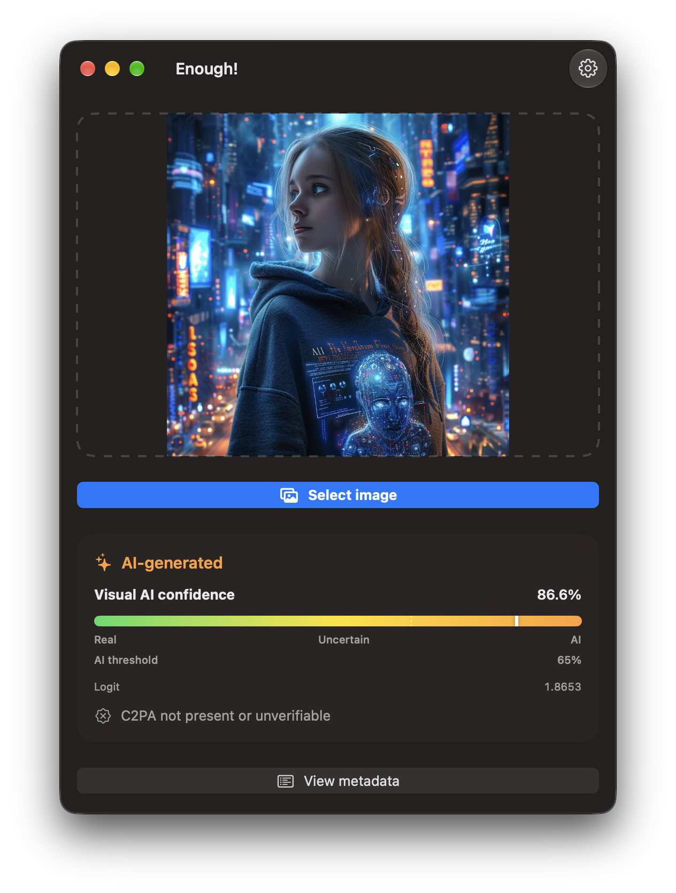
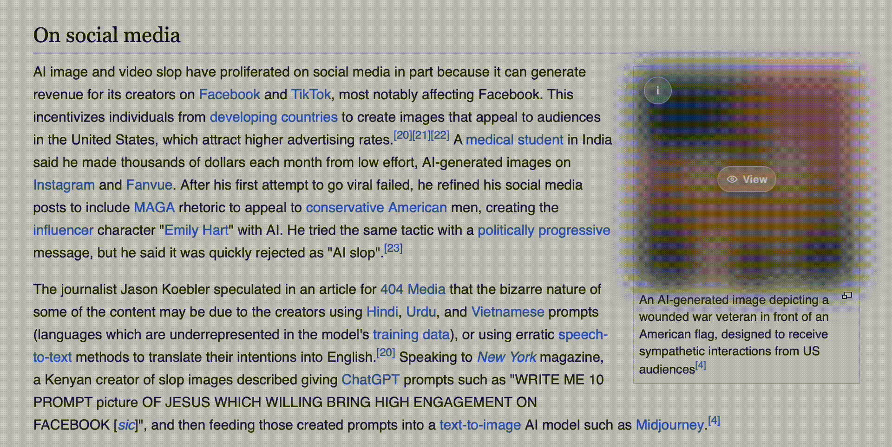

# _Enough!_

**Enough Slop**
Reconquer the web. Enjoy again.

_Enough!_ is a native SwiftUI app and Safari extension that can mark AI images on web pages. It analyzes images locally through CoreML to estimate whether they were generated by AI
and C2PA to verify their provenance when available.

> ⚠️ Available for MacOS >= 26 with Apple Sillicon. Not notaraized, you must allow it on Settings > Security. [Download Release](https://github.com/roicort/Enough/releases/tag/v0.1.0-alpha)

> For iOS must clone the XCode Project and build it yourself.



## Provenance analysis

Before using the visual classifier, _Enough!_ checks the image's C2PA data:

- A verified declared digital capture is shown as authentic content.
- A verified declared AI origin is shown as AI-generated.
- Images without verifiable provenance are classified visually.

The absence of C2PA does not prove that an image is either authentic or
AI-generated.

## Visual classification

Enough uses CoreML to classify wether an image was AI generated.

Its exported Core ML package simplifies that output to a single value:

```text
logit = FAKE logit - REAL logit
```

This logit is not constrained to a fixed range such as `-6...6`; it can take
any real value. _Enough!_ converts it to an AI confidence between `0` and `1`
using the sigmoid function:

```text
confidence = 1 / (1 + exp(-logit))
```

| Logit | Approximate AI confidence |
| ---: | ---: |
| `-6` | `0.25%` |
| `-2` | `11.9%` |
| `0` | `50%` |
| `2` | `88.1%` |
| `6` | `99.75%` |

The interface represents this normalized confidence, not the logit directly:

```text
Real  <----------------  Uncertain  ---------------->  AI
0%                         50%                         100%
```

The configurable threshold determines when _Enough!_ presents a visual prediction
as AI-generated. It is a classifier estimate, not definitive evidence of an
image's origin.

### Core ML models

_Enough!_ uses open source pre-trained models.

| Package | Status | Input feature | Input type and shape | Output feature |
| --- | --- | --- | --- | --- |
| [`w5810_best_fp16`](./Models/w5810_best_fp16.mlpackage) | Active | `input` | `MLMultiArray`, `Float32[1, 3, 384, 384]` | `logit`, `MLMultiArray Float32[1, 1]` |
| [`capcheck_ai_image_detection`](./Models/capcheck_ai_image_detection.mlpackage) | Alternative | `input` | Core ML RGB image, `224 × 224` | `logit`, `MLMultiArray Float32[1, 1]` |


## Safari Extension



The Safari extension downloads images already present on the page, analyzes
them locally, and overlays the result without uploading image data to a server.

For images that receive a visual classification, the overlay provides an
information icon that reveals the same normalized score system as the app on
hover, focus, or tap:

```text
Real  <----------------  Uncertain  ---------------->  AI
0%                         50%                         100%
```

The white marker shows the current visual AI confidence. A dashed marker shows
the AI confidence threshold configured in the app. Images at or above that
threshold are blurred until the user selects **View**.

### C2PA chips

The extension only displays C2PA chips for verified provenance:

| C2PA state | Overlay behavior |
| --- | --- |
| No C2PA data or unverifiable C2PA | No C2PA chip |
| C2PA present but source type not declared | No C2PA chip |
| Verified digital capture | Always show the digital-capture chip; never blur the image |
| Verified AI declaration | Show the AI-declared chip only when **Show verified AI C2PA** is enabled in **Settings > Extension** |

The **Show verified AI C2PA** preference is enabled by default and is stored in
the shared App Group, so the app and Safari extension use the same setting.

## Notes and Caveats

Although Sieve is a small model, browsing webpages with seaveral images may impact battery life. Make sure to give access to the extension only on certain sites. AI recognition is not pefect and may contain false positives and false negatives (Refer to model docs). 

> ⚠️ You may not use _Enough!_ to certify a real or ai-generated image. 

> ✅  A human must always double-check the image with care and critical thinking.

## Open-source licenses

**Settings > Legal > Open-source licenses** lists the packages bundled with
Enough, their resolved versions, license, and repository link.

The Enough source repository is available at
[github.com/roicort/Enough](https://github.com/roicort/Enough).

| Dependency | Version | License |
| --- | ---: | --- |
| [C2PA Swift](https://github.com/contentauth/c2pa-swift) | 0.0.14 | Apache License 2.0 |
| [Swift ASN.1](https://github.com/apple/swift-asn1) | 1.7.3 | Apache License 2.0 |
| [Swift Certificates](https://github.com/apple/swift-certificates) | 1.21.0 | Apache License 2.0 |
| [Swift Crypto](https://github.com/apple/swift-crypto) | 4.5.2 | Apache License 2.0 |

## License

GNU General Public License v3.0